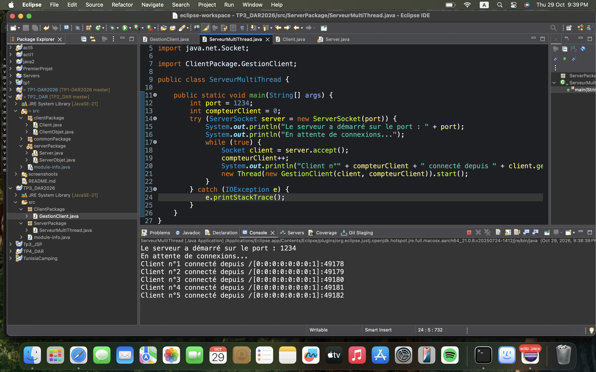
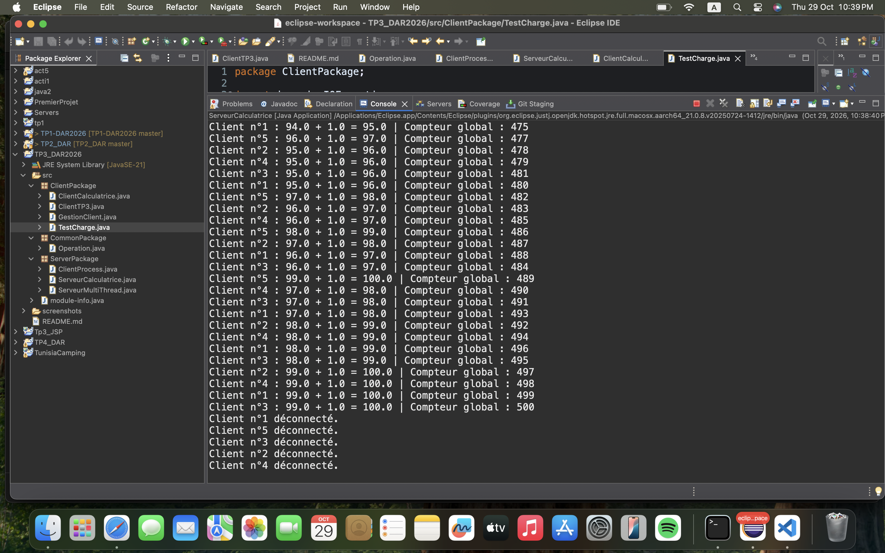
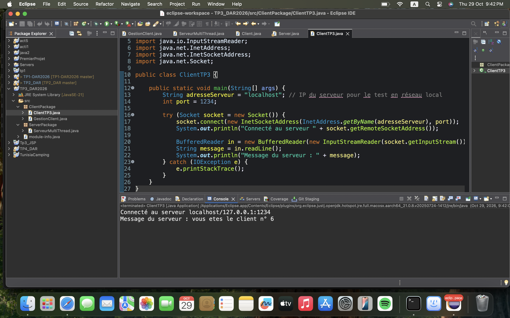
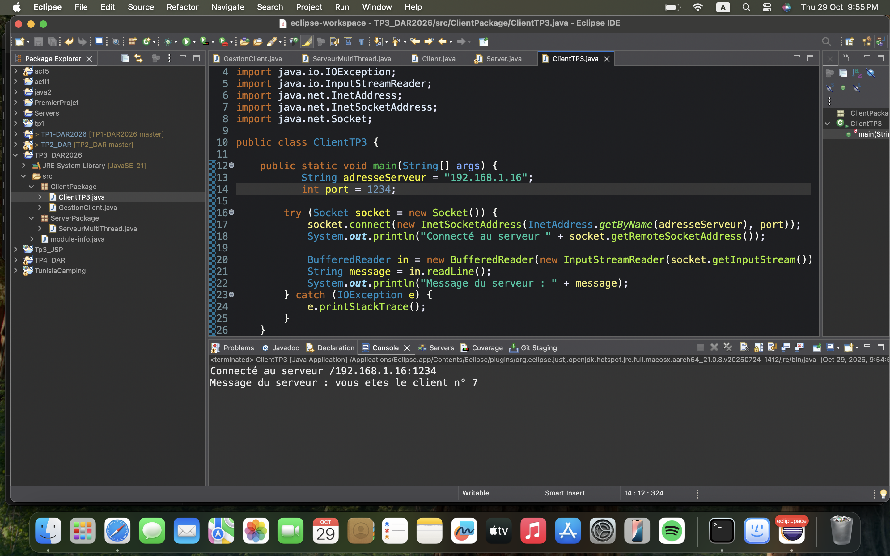

# TP3 : Serveur multi-threads, sockets TCP en mode connecté (Activité 3-1)

**Matière :** Développement d'applications réparties
**Étudiant :** Younes Bouaicha
**Projet Eclipse :** `TP3_DAR2026`

---

## 1. Objectif

Faire évoluer l'application Client/Serveur des TP1 et TP2, qui ne gérait qu'un seul client par exécution, vers un **serveur multi-thread** capable de traiter plusieurs clients simultanément avec les sockets TCP en Java.

## 2. Environnement

- JDK 21 (JavaSE-21)
- Eclipse IDE for Java Developers
- macOS
- Git / GitHub

## 3. Structure du projet

```
TP3_DAR2026/
└── src/
    ├── ServerPackage/
    │   └── ServeurMultiThread.java   # serveur : boucle accept() + un thread par client
    └── ClientPackage/
        ├── GestionClient.java        # Runnable : dialogue avec UN client
        └── ClientTP3.java            # client Java (adresse du serveur configurable)
```

## 4. Principe de fonctionnement

**Serveur (`ServeurMultiThread`)**

1. Crée un `ServerSocket` sur le port **1234**.
2. Boucle infinie : `accept()` attend un client.
3. À chaque connexion, incrémente un compteur (`compteurClient`) et affiche côté serveur le **numéro d'ordre** et l'**adresse IP + port** du client grâce à `getRemoteSocketAddress()`.
4. Crée un `Thread` avec un objet `GestionClient` et le démarre, puis retourne immédiatement à `accept()` pour accepter le client suivant.

```java
while (true) {
    Socket client = server.accept();
    compteurClient++;
    System.out.println("Client n°" + compteurClient + " connecté depuis " + client.getRemoteSocketAddress());
    new Thread(new GestionClient(client, compteurClient)).start();
}
```

**Gestion d'un client (`GestionClient`)**

Dans `run()`, le thread envoie au client son numéro d'ordre (`vous etes le client n° X`) puis ferme la socket (`try-with-resources`).

**Client Java (`ClientTP3`)**

Se connecte avec `InetAddress` et `InetSocketAddress` à l'adresse du serveur (variable `adresseServeur`), lit le message du serveur et l'affiche.

## 5. Tests

### 5.1 Tests locaux avec plusieurs clients `nc`

`telnet` n'est pas installé par défaut sur macOS. J'ai utilisé **`nc` (netcat)**, qui joue exactement le même rôle (client TCP en ligne de commande) :

```bash
nc localhost 1234
```

Plusieurs terminaux ont été ouverts : chaque client reçoit son propre numéro (1, 2, 3, ...) et le serveur reste disponible pour les suivants.





### 5.2 Test avec le client Java (localhost)

Avec `adresseServeur = "localhost"` :



Côté serveur, le client est vu depuis `127.0.0.1`.

### 5.3 Test en réseau local

Pour tester avec l'adresse réseau du serveur et non avec `localhost`, l'adresse IP de la machine a été récupérée avec `ipconfig getifaddr en0` (**192.168.1.16**), puis `adresseServeur` a été changée :

```java
String adresseServeur = "192.168.1.16";
```

Le client se connecte via `InetAddress.getByName(...)` et `InetSocketAddress`. Le serveur affiche alors l'adresse réseau du client (`/192.168.1.16:49186`) au lieu de `localhost`, ce qui prouve que le serveur accepte les connexions arrivant par l'interface réseau.



> **Remarque :** je n'avais pas de seconde machine disponible. Le test réseau a donc été fait sur la même machine, en passant par l'adresse IP du réseau Wi-Fi. Pour une machine distante, il suffit de lancer `ClientTP3` avec `adresseServeur` égale à l'IP du serveur (même réseau, pare-feu autorisant Java).

## 6. Difficultés rencontrées

| Problème | Cause | Solution |
|---|---|---|
| `java.net.BindException: Address already in use` | Une ancienne instance du serveur tournait encore (boucle `while(true)`) et occupait le port 1234 | Trouver le processus avec `lsof -nP -iTCP:1234 -sTCP:LISTEN`, l'arrêter avec `kill <PID>`, et toujours arrêter le serveur avec le carré rouge de la console avant de le relancer |
| Erreur de compilation sur `try (client; ...)` | La variable doit être `final` ou effectivement finale | Déclarer les champs `private final Socket client;` et `private final int numeroClient;` |
| Message affiché sans espaces | Concaténation sans espaces entre les chaînes | Ajout des espaces dans le `println` |

## 7. Synthèse

- Un serveur **mono-thread** traite un client à la fois : les suivants attendent. Avec un **thread par client**, la boucle principale ne fait qu'`accept()` et délègue le dialogue à `GestionClient`, ce qui permet de servir plusieurs clients en parallèle.
- Le serveur identifie chaque client par un **numéro d'ordre** et son **adresse IP:port** (`getRemoteSocketAddress()`).
- La socket de chaque client est fermée à la fin de son thread (`try-with-resources`), pour ne pas laisser de connexions ouvertes.
- Le port d'écoute est unique : une seule instance du serveur peut tourner à la fois, sinon `BindException`.

## 8. Exécution

1. Lancer `ServerPackage.ServeurMultiThread`.
2. Lancer un ou plusieurs clients : `nc localhost 1234` ou `ClientPackage.ClientTP3` (adapter `adresseServeur`).
3. Arrêter le serveur depuis la console Eclipse avant de le relancer.
