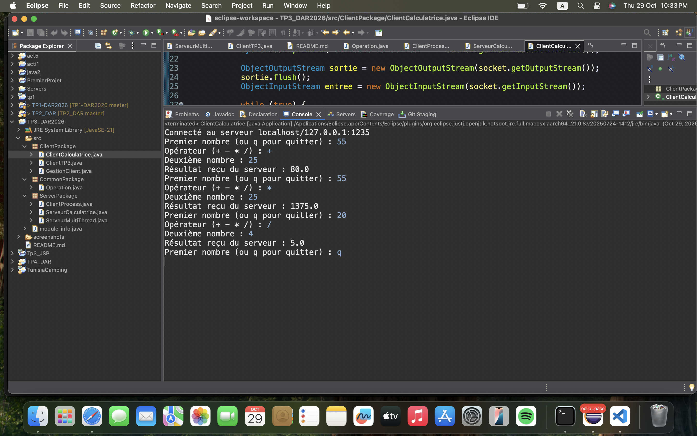
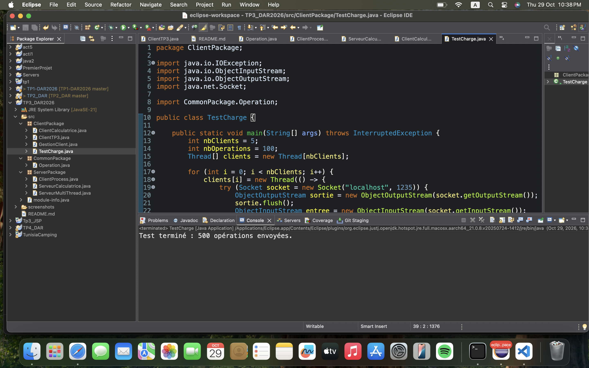

---

# Activité 3-2 : Amélioration de l'application calculatrice (serveur multi-thread)

## 1. Objectif

Reprendre le service de calculatrice par objets du TP2 (activité 2-2) pour qu'un même serveur accepte **plusieurs clients simultanément**, avec **un thread dédié par client** (`ClientProcess`), et protéger par synchronisation un **compteur global** d'opérations partagé entre les threads.

## 2. Fichiers ajoutés

```
src/
├── CommonPackage/
│   └── Operation.java            # objet Serializable échangé : nombre1, opérateur, nombre2
├── ServerPackage/
│   ├── ServeurCalculatrice.java  # port 1235 : boucle accept() + un thread par client
│   └── ClientProcess.java        # Runnable : readObject -> calcul -> writeObject, compteur global
└── ClientPackage/
    ├── ClientCalculatrice.java   # client interactif (saisie au clavier, adresse du serveur configurable)
    └── TestCharge.java           # 5 clients simultanés x 100 opérations (test de charge)
```

Le service de l'activité 3-1 (`ServeurMultiThread`, port 1234) est conservé tel quel. Le serveur calculatrice utilise le **port 1235** pour que les deux serveurs puissent tourner en même temps sans conflit.

## 3. Communication par objets

- Le client envoie un objet `Operation` (classe `Serializable`) avec `ObjectOutputStream.writeObject()`.
- Le serveur lit l'objet, calcule, puis renvoie le résultat (`Double`).
- Pour éviter un blocage (deadlock) à l'ouverture des flux, **l'`ObjectOutputStream` est créé en premier et `flush()` est appelé** avant la création de l'`ObjectInputStream`, des deux côtés.
- Chaque client peut envoyer autant d'opérations qu'il veut. Quand il se ferme, le serveur reçoit une `EOFException`, traitée comme une fin normale (`Client n°X déconnecté.`).
- Division par zéro et opérateur invalide : le serveur renvoie `NaN`.

## 4. Gestion de l'accès concurrent : compteur global

Le compteur du nombre total d'opérations traitées est une **ressource critique** partagée entre tous les threads `ClientProcess`. Il est déclaré `static` (une seule copie pour tous les clients) et modifié dans une méthode `synchronized` :

```java
private static int compteurGlobal = 0;

private static synchronized int incrementerCompteur() {
    compteurGlobal++;
    return compteurGlobal;
}
```

À chaque opération calculée, le thread appelle `incrementerCompteur()` et affiche la valeur retournée dans la console du serveur. La méthode étant `synchronized`, **un seul thread à la fois** peut lire puis modifier le compteur (verrou sur la classe `ClientProcess`). L'incrément et la lecture sont dans la même section critique, donc la valeur affichée est cohérente.

## 5. Tests

### 5.1 Client interactif

Test d'un client qui envoie plusieurs opérations (`55 + 25`, `55 * 25`, `20 / 4`) :



### 5.2 Plusieurs clients en parallèle

`TestCharge` lance **5 clients simultanés** (un thread par client), chacun envoyant **100 opérations**. Dans la console du serveur, les messages des différents clients sont **entremêlés**, ce qui montre qu'ils sont traités en parallèle :


### 5.3 Cohérence du compteur global

Après le test, la dernière ligne du serveur affiche `Compteur global : 500` (5 clients x 100 opérations) : aucune opération n'est perdue ni comptée deux fois.



### 5.4 Test en réseau local

Je n'avais pas de seconde machine. Comme pour l'activité 3-1, j'ai remplacé `localhost` par l'adresse IP du réseau local de la machine serveur (`192.168.1.16`) dans `ClientCalculatrice` :

```java
String adresseServeur = "192.168.1.16";
```

Le serveur affiche alors `Client n°X connecté depuis /192.168.1.16:...`. Pour une machine distante, il suffit d'indiquer l'adresse IP du serveur (même réseau, pare-feu autorisant Java).


### 5.5 Démonstration : que se passe-t-il sans `synchronized` ?

Pour vérifier l'utilité de la synchronisation, j'ai retiré `synchronized` de `incrementerCompteur()` en ajoutant une courte pause entre la lecture et l'écriture du compteur :

```java
private static int incrementerCompteur() {
    int temp = compteurGlobal;
    try { Thread.sleep(5); } catch (InterruptedException e) { }
    compteurGlobal = temp + 1;
    return compteurGlobal;
}
```

Avec les mêmes 5 clients x 100 opérations, le compteur final est **XXX** au lieu de 500 : plusieurs threads lisent la même valeur et s'écrasent mutuellement (**condition de concurrence**). Après avoir remis `synchronized`, le compteur atteint de nouveau exactement 500.


## 6. Difficultés rencontrées

| Problème | Solution |
|---|---|
| Conflit de port entre les deux serveurs | Serveur calculatrice sur le port 1235, serveur 3-1 sur le port 1234 |
| Risque de deadlock avec les flux d'objets | Créer l'`ObjectOutputStream` et appeler `flush()` avant de créer l'`ObjectInputStream` |
| `EOFException` quand un client se déconnecte | Intercepter l'exception et afficher « Client n°X déconnecté. » |
| `serializable.java` (interface vide) dans le `commonPackage` du TP2 | Non reprise : `Operation` implémente `java.io.Serializable` |

## 7. Synthèse

- Le serveur de l'activité 3-2 suit le même schéma que celui de l'activité 3-1 : `accept()` dans une boucle, puis un thread dédié (`ClientProcess`) qui gère la conversation avec chaque client. Les clients sont donc indépendants les uns des autres.
- L'échange par objets (`Operation` sérialisable) remplace l'échange de texte, ce qui évite d'analyser des chaînes de caractères côté serveur.
- Le compteur global illustre le problème de l'**accès concurrent** : sans synchronisation, des mises à jour sont perdues. Avec `synchronized`, le résultat est toujours exact (500 pour le test de charge).
- Le test en réseau local est fait en passant par l'adresse IP de la machine plutôt que `localhost`.